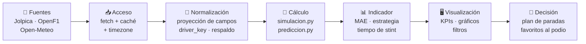

# Arquitectura de la solución — Apex Analytics · F1

Herramienta seleccionada, organización de componentes, flujo de información desde
la fuente hasta la visualización, y justificación del diseño en función de las
consultas y decisiones del usuario.

---

## 1. Herramienta seleccionada

**Streamlit (Python) + Plotly + pandas + scikit-learn**, empaquetado con Docker y
versionado con Git.

El proyecto no es solo una hoja de cálculo: necesita **entrenar y evaluar un modelo
de predicción** (validación temporal 2024/2025), **simular estrategias con Monte
Carlo** y **consumir tres APIs** en vivo. Por eso se eligió un entorno de
programación en lugar de una herramienta de hojas.

| Criterio | Excel / Sheets | Power BI / Tableau | **Streamlit (elegida)** |
|---|---|---|---|
| Modelo ML con *train/eval* | Muy limitado | Vía script externo | **Nativo** (`scikit-learn`) |
| Simulación Monte Carlo | Volátil | No nativo | **Nativo** |
| Consumo de 3 APIs | Add-ins/frágil | Conector | **`urllib` de la stdlib** |
| Versionado y *diff* | Binario | `.pbix` binario | **Texto (Git)** |
| Reproducibilidad | Manual | Licencia/servicio | **`docker compose up`** |
| Coste | Licencia | Licencia | **Libre** |
| Filtros interactivos | Sí | Sí | **Sí (`st.selectbox`, `multiselect`)** |

**Lo decisivo:** el modelo de predicción y la simulación de estrategia exigen
cálculo numérico y validación estadística; una hoja no permite reproducir el
*split* temporal ni medir MAE/Spearman de forma auditable.

---

## 2. Organización de los componentes

La solución se organiza en **5 capas** con dependencias en un solo sentido: la
presentación no sabe de dónde vienen los datos, solo consume lo que expone la capa
de cálculo.

| Capa | Componente | Responsabilidad |
|---|---|---|
| **1. Fuentes** | Jolpica/Ergast · OpenF1 · Open-Meteo | Proveen el dato crudo vía HTTP |
| **2. Acceso y normalización** | `openf1.py`, `historial.py`, `fetch_*` en `app.py` | Petición, caché, *timezone*, proyección de campos y **respaldo de fuente** |
| **3. Dominio y cálculo** | `simulacion.py`, `prediccion.py`, `circuits.py` | Fórmulas puras: estrategia, modelo, geometría |
| **4. Presentación** | `app.py`, `assets/style.css` | Secciones, KPIs, gráficos y filtros |
| **5. Documentación** | `docs/` | Diccionario, fichas de KPI, planes |

**Principio de diseño:** cada módulo tiene una sola responsabilidad y **no se
acopla** a otro. `prediccion.py` no sabe que existe Streamlit; `app.py` no calcula
fórmulas, solo las invoca.

### Secciones del dashboard

| Sección | Componente principal | Contenido |
|---|---|---|
| **Raceweek** | `render_overview()` | GP de la semana, KPIs de contexto, clima, circuito (curvas y sectores), calendario |
| **Simulacion** | `render_prediction()` + `simulacion.py` | Recomendación de estrategia, ranking, tiempo por vuelta |
| **Historial** | `render_history()` + `historial.py` | Comparativa de stints y KPIs del modelo |
| **Transversal** | `render_credits_footer()` + barra de interés | Fuentes, créditos y uso |

---

## 3. Flujo de información: de la fuente a la visualización

**El recorrido completo, con un ejemplo real** (tiempo medio de vuelta por stint):

1. **Fuente.** OpenF1 devuelve las vueltas de Bahrain 2024 (1129 registros, 16
   campos cada uno). Si no responde, Jolpica entrega el mismo dato vía
   `/laps` + `/pitstops`.
2. **Acceso.** `historial.fetch_laps()` pide **una vez** y guarda en caché 24 h.
3. **Normalización.** Se **proyecta** el payload a 4 campos (de 16), se unifica la
   llave del piloto a `driver_key` y se marca la vuelta posterior a cada parada
   como `is_pit_out_lap`.
4. **Cálculo.** `_stint_metrics()` filtra las vueltas válidas del stint y aplica
   `avg = Σtᵢ/m` y `best = min(tᵢ)`.
5. **Indicador.** "Tiempo medio por stint" con su unidad (segundos).
6. **Visualización.** Timeline de stints y dispersión *avg vs. best* en Historial.
7. **Decisión.** Comparar el ritmo de un piloto por compuesto para decidir un
   *undercut* o una ventana de parada.

**Regla del flujo:** ningún dato llega a la pantalla sin pasar por las capas 2 y 3.
La interfaz **solo recibe** valores ya calculados; nunca hace aritmética propia.

---

## 4. Justificación del diseño: consultas y decisiones

El diseño sigue el mantra clásico de la visualización de información
(**Shneiderman**): *overview first, zoom and filter, then details-on-demand*.

| Principio | Cómo se aplica | Efecto en el usuario |
|---|---|---|
| **Panorama primero** | KPIs y calendario al tope de Raceweek | El usuario entiende el contexto (qué GP, cuándo) antes de pedir detalle |
| **Zoom y filtro** | Filtro de sectores, multiselección de pilotos, selectores de temporada y carrera | Reduce el ruido y aísla la comparación deseada |
| **Detalle a demanda** | *Tooltips* en cada marca, tabla de stints, parámetros del circuito | El detalle aparece cuando se necesita, sin saturar la vista |
| **Proximidad filtro→resultado** | El filtro vive junto a lo que afecta | El usuario ve el efecto de su acción de inmediato |
| **Convención de color** | Paleta Pirelli (rojo=soft, amarillo=medium, blanco=hard, verde=intermedio, azul=mojado) | No hay que aprender una leyenda nueva: usa la del dominio |
| **Decisión explícita** | Banner "Estrategia recomendada" + margen vs. 2.ª | La recomendación se lee sin interpretar tablas |
| **Trazabilidad visible** | Badge de fuente ("OpenF1" / "Jolpica") y créditos | El usuario confía en el origen del dato |
| **Rapidez para explorar** | Caché (30 min / 24 h) y contenedor local | La exploración no se rompe por esperas |

**Cómo facilita las consultas.** Cada control responde a una pregunta concreta:
*¿qué se corre esta semana?* (Raceweek) · *¿cuál es la mejor estrategia aquí?*
(Simulacion) · *¿cómo rindió cada piloto por compuesto?* (Historial) · *¿qué tan
bueno es el modelo?* (KPIs). El usuario no consulta "todo": consulta una pregunta
por vez y el diseño la responde en la misma pantalla.

**Cómo facilita las decisiones.** Cada indicador tiene una decisión asociada y
declarada (ver `docs/fichas-kpi.md`), y algunas vistas la muestran de forma
explícita: la estrategia recomendada se presenta con su **margen** y su
**dispersión de Monte Carlo**, de modo que el usuario sabe si la decisión es clara
o ajustada antes de tomarla.

---

## 5. Cita sobre claridad y diseño de dashboards

> Un dashboard es *"una presentación visual de la información más importante
> necesaria para lograr uno o más objetivos, consolidada y organizada en una sola
> pantalla para que la información pueda monitorearse de un solo vistazo."*

— **Stephen Few**, *Information Dashboard Design: The Effective Visual
Communication of Data* (O'Reilly, 2006).

Ese principio rige este proyecto: la información clave se **consolida** (KPIs),
se **organiza** por secciones y se dispone para leerse **de un vistazo**
(recomendación, marcadores y semáforo de sectores), sin obligar al usuario a
navegar entre pantallas para reconstruir el estado.

Como apoyo:

> *"Panorama primero, luego zoom y filtrado, después detalle bajo demanda."*
> — **Ben Shneiderman**, *The Eyes Have It* (1996).

> *"Por encima de todo, muestre los datos."*
> — **Edward Tufte**, *The Visual Display of Quantitative Information* (1983).

---

## 6. Estructura mínima del trabajo final

| Hoja o componente | Contenido | Equivalente en este proyecto |
|---|---|---|
| **Datos** | Tabla base organizada y depurada | Conjuntos normalizados de `historial.py` (sesiones, pilotos, stints, vueltas) + calendario y resultados de Jolpica + clima de Open-Meteo. Depurada por proyección de campos (16 → 4 en vueltas), unificación de llave (`driver_key`) y descarte de registros incompletos. |
| **Diccionario** | Definición y características de las variables | `docs/diccionario-variables.md`: ~150 variables con nombre, descripción, tipo/unidad, rango o categorías y tratamiento de faltantes, agrupadas en 18 bloques por origen. |
| **Tablas dinámicas / Cálculos** | Fórmulas, agregaciones y cálculos de indicadores | `simulacion.py`: `t_vuelta = base + pace + deg_rate·deg_factor·(v−1) + cliff` y `T_total = Σt_vuelta + n·pit_loss` con Monte Carlo. `prediccion.py`: features causales y Ridge `α=1.0`. Agregaciones de stint (`avg`, `best`, `laps_completed`) y métricas del modelo (MAE, RMSE, acierto de podio, Spearman). |
| **Dashboard** | Visualizaciones, indicadores y filtros | `app.py` + `assets/style.css`: 4 secciones (Raceweek · Simulacion · Historial · Modelo), KPIs con unidad, timeline de stints, dispersión *avg/best*, mapa procedural con curvas y sectores, y filtros (sectores, pilotos, temporada, carrera). |
| **Interpretación (decisiones)** | Lectura de resultados y decisiones que permite apoyar | `docs/fichas-kpi.md`: cada KPI declara la **decisión que apoya** (p. ej. número de paradas → ventanas de pit; acierto de podio → favoritos; riesgo de lluvia → compuesto). La interfaz muestra la recomendación con su margen y dispersión para que la decisión sea informada. |

### Correspondencia con el flujo de información

| Hoja / componente | Capa de la arquitectura | Módulo |
|---|---|---|
| Datos | Fuentes + Acceso | `openf1.py`, `historial.py` |
| Diccionario | Documentación | `docs/diccionario-variables.md` |
| Tablas dinámicas / Cálculos | Dominio y cálculo | `simulacion.py`, `prediccion.py`, `circuits.py` |
| Dashboard | Presentación | `app.py`, `assets/style.css` |
| Interpretación (decisiones) | Documentación + Presentación | `docs/fichas-kpi.md`, banners de resultado |

**Cierre.** La estructura mínima se cumple de extremo a extremo: los **datos** se
depuran antes de usarse, el **diccionario** los describe, las **tablas de cálculo**
los convierten en indicadores, el **dashboard** los expone con filtros y la
**interpretación** los traduce en decisiones. Ninguna capa se salta a la siguiente.
